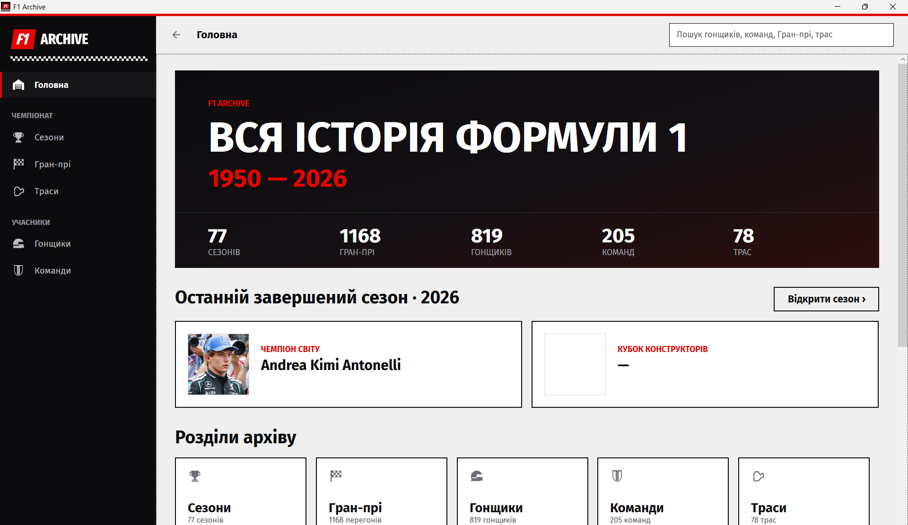
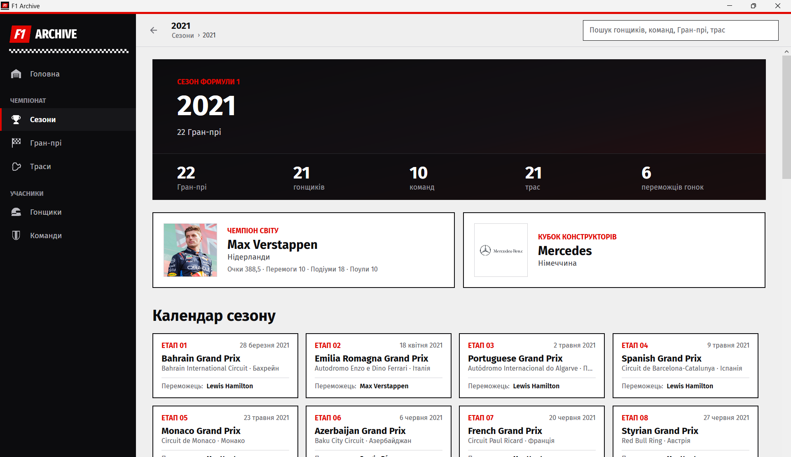
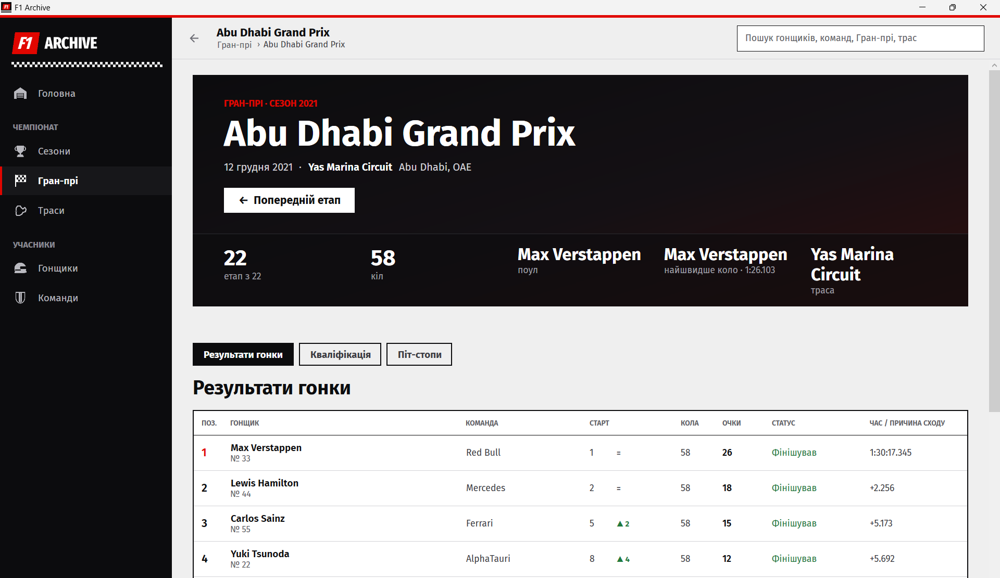
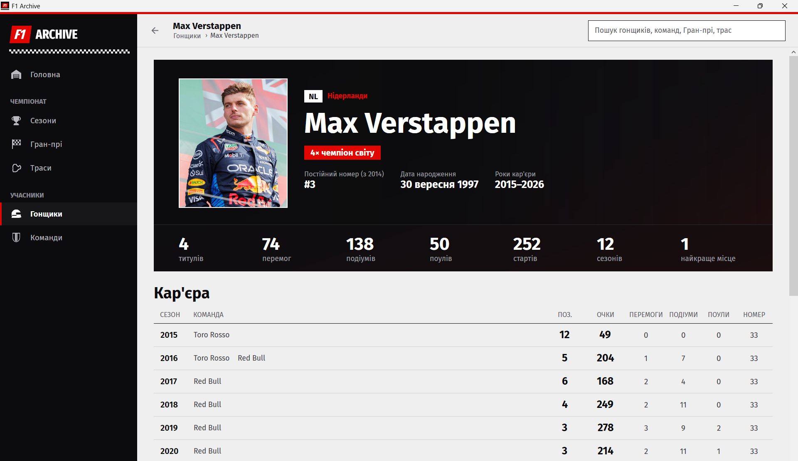
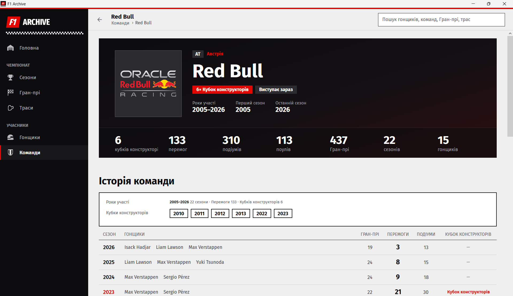
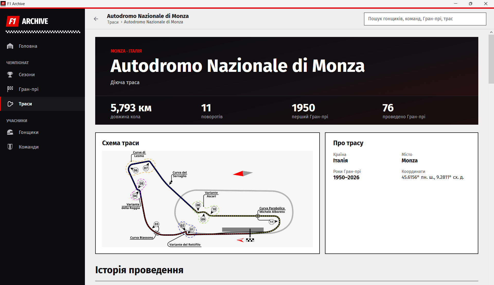
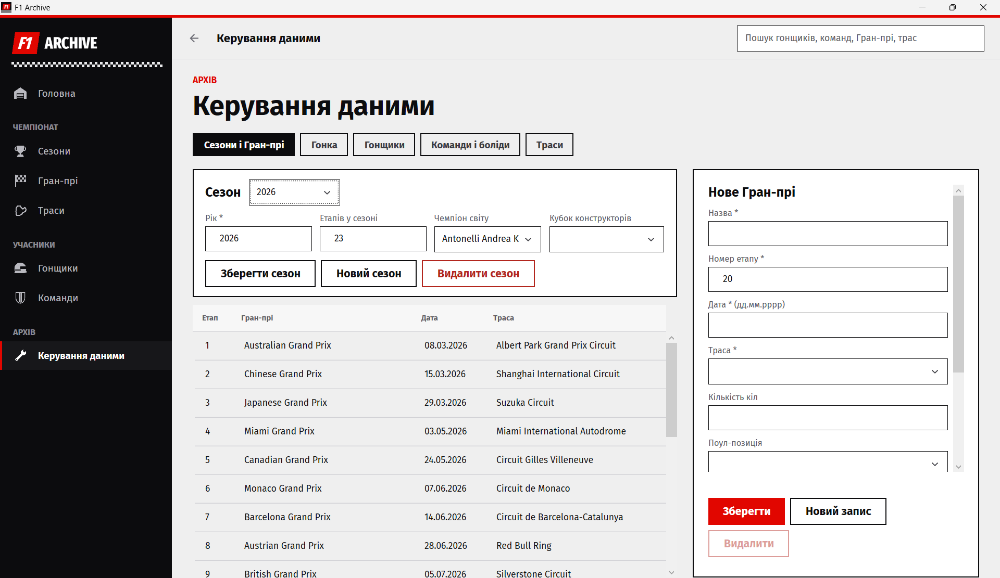
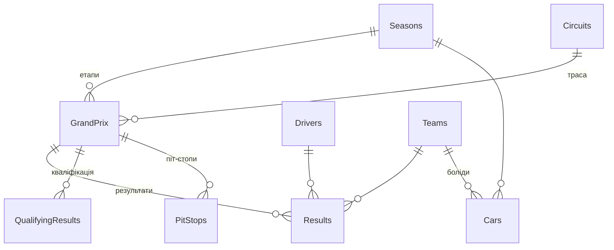

Програма для перегляду історії Формули 1: сезони, Гран-прі, гонщики, команди і траси з 1950 року до сьогодні.
Курсова робота на тему "Проєктування АІС історичного архіву Формули 1".

## Завантажити

1. Відкрийте сторінку [Releases](https://github.com/Vumirka/F1Archive/releases) і завантажте архів `F1Archive-v1.0.0.zip`.
2. Розпакуйте його в будь-яку папку.
3. Запустіть `F1Archive.exe`.

Встановлювати нічого не потрібно.

## Що вміє програма

- **Сезони:** чемпіони, календар етапів, особистий залік і команди.
- **Гран-прі:** результати гонки, кваліфікація і піт-стопи.
- **Гонщики і команди:** кар'єра по сезонах, перемоги, подіуми і титули.
- **Траси:** схема, довжина кола та історія Гран-прі.
- **Пошук:** одне поле шукає гонщиків, команди, Гран-прі і траси.
- **Керування даними:** додавання і зміна записів. Цей розділ є лише у версії для розробки.

## Скриншоти

| Сезон | Гран-прі |
|:---:|:---:|
|  |  |
| **Гонщик** | **Команда** |
|  |  |
| **Траса** | **Керування даними** |
|  |  |

## Запуск з коду

1. Відкрийте `F1Archive.slnx` у Visual Studio 2026.
2. Натисніть **F5**.

База даних і фото лежать у папці `F1Archive/Database`, програма знаходить їх сама.

## База даних

Головна таблиця `Results` зберігає результат одного гонщика в одному Гран-прі.
Перемоги, подіуми, титули і залік сезону програма рахує з неї, тому окремо вони не зберігаються.

Для збору нових даних є таблиця [`docs/F1Archive_дані.xlsx`](docs/F1Archive_дані.xlsx).
Колонки в ній ідуть у тому самому порядку, що й поля у формах програми.

## Автор

Ріжкевич Вікторія, група 45
Полтавський політехнічний фаховий коледж НТУ "ХПІ"
