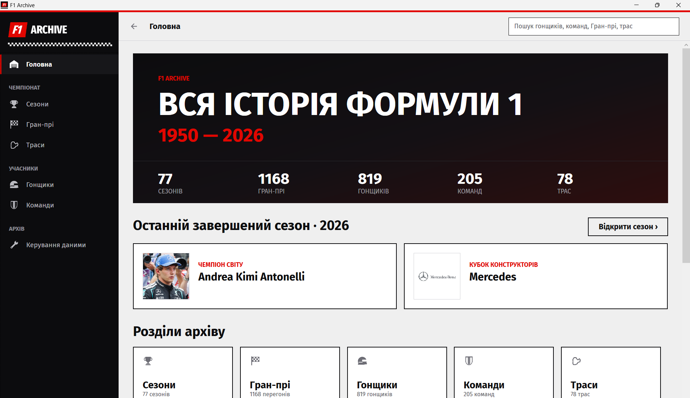
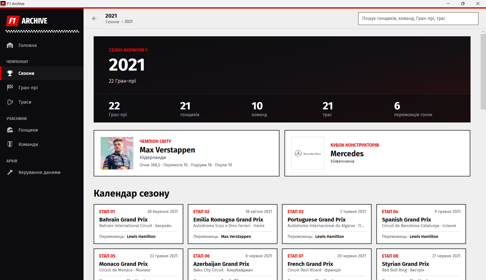
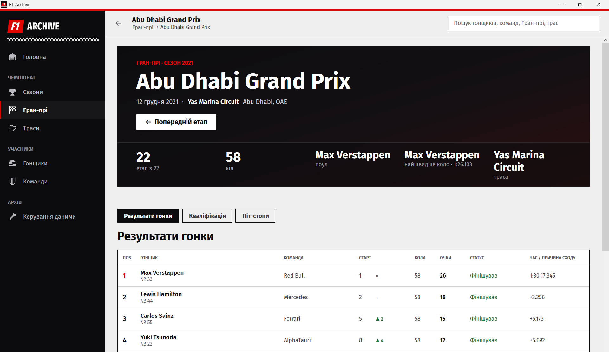
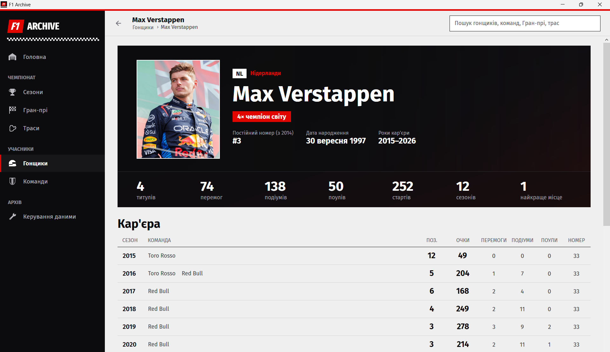
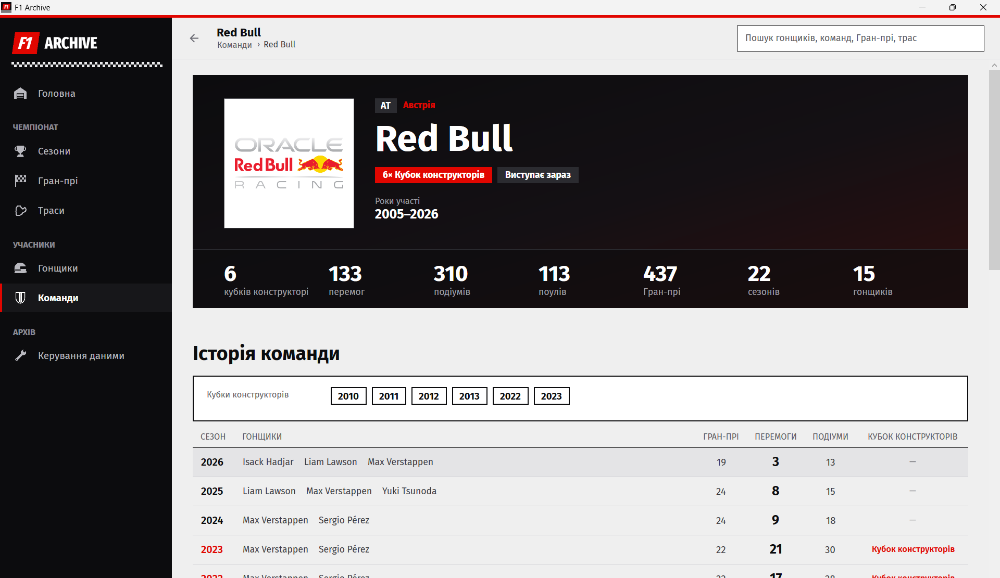
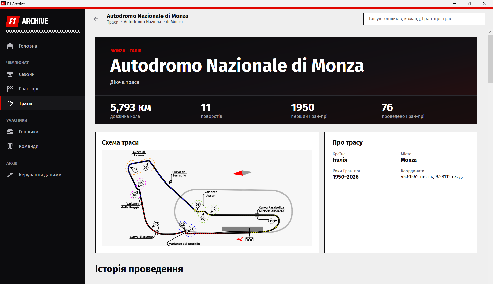
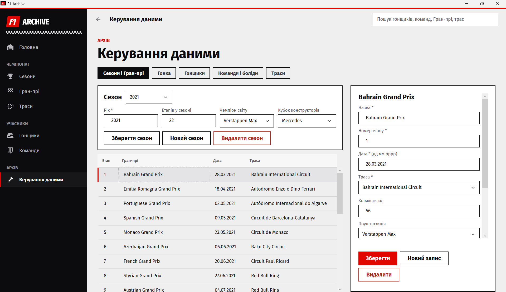

Програма для перегляду історії Формули 1: сезони, Гран-прі, гонщики, команди і траси з 1950 до 2026 року.
Курсова робота на тему "Проєктування АІС історичного архіву Формули 1".

## Завантажити

1. Відкрийте сторінку [Releases](https://github.com/Vumirka/F1Archive/releases) і завантажте архів `F1Archive-v1.0.0.zip`.
2. Розпакуйте його в будь-яку папку.
3. Запустіть `F1Archive.exe`.

Встановлювати нічого не потрібно.

## Що вміє програма

- Показує кожен сезон з чемпіонами, календарем етапів, особистим заліком і командами-учасницями.
- Для кожного Гран-прі показує результати гонки, а також кваліфікацію і піт-стопи, якщо вони є в базі.
- На сторінках гонщиків і команд видно їхню кар'єру по сезонах, перемоги, подіуми і титули.
- Для трас показано довжину кола, кількість поворотів, історію Гран-прі, які там проходили, і схему, якщо її додано.
- Одне поле пошуку знаходить гонщиків, команди, Гран-прі і траси.
- Дані можна додавати і змінювати в розділі "Керування даними". Цей розділ видно лише тоді, коли програму запущено з Visual Studio в режимі Debug.

## Скриншоти

| Сезон | Гран-прі |
|:---:|:---:|
|  |  |
| **Гонщик** | **Команда** |
|  |  |
| **Траса** | **Керування даними** |
|  |  |

## Запуск з коду

1. Відкрийте `F1Archive.slnx` у Visual Studio 2026.
2. Натисніть **F5**.

База даних і фото лежать у папці `F1Archive/Database`, програма знаходить їх сама.

## База даних

Програма працює з базою SQLite. У ній вісім таблиць:

| Таблиця | Що зберігає |
|---|---|
| `Seasons` | Рік, кількість етапів, чемпіон серед гонщиків і чемпіон серед команд |
| `GrandPrix` | Етапи сезону: назва, дата, траса, кількість кіл, поул і найшвидше коло |
| `Results` | Результати гонок: місце, очки, статус |
| `QualifyingResults` | Результати кваліфікацій |
| `PitStops` | Піт-стопи |
| `Drivers` | Гонщики |
| `Teams` | Команди |
| `Circuits` | Траси |

Перемоги, подіуми, старти і особистий залік сезону окремо не зберігаються: програма рахує їх з таблиці `Results`. Поули рахуються з таблиці `GrandPrix`, а титули з чемпіонів у таблиці `Seasons`.
